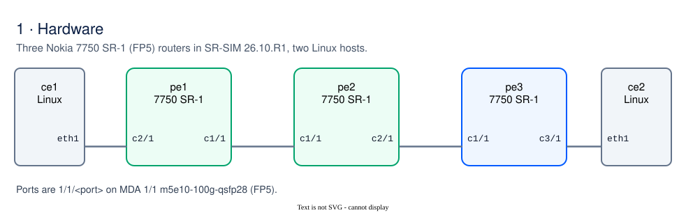
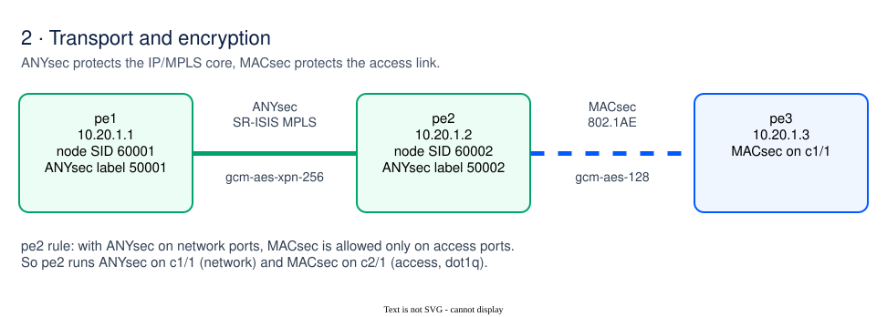
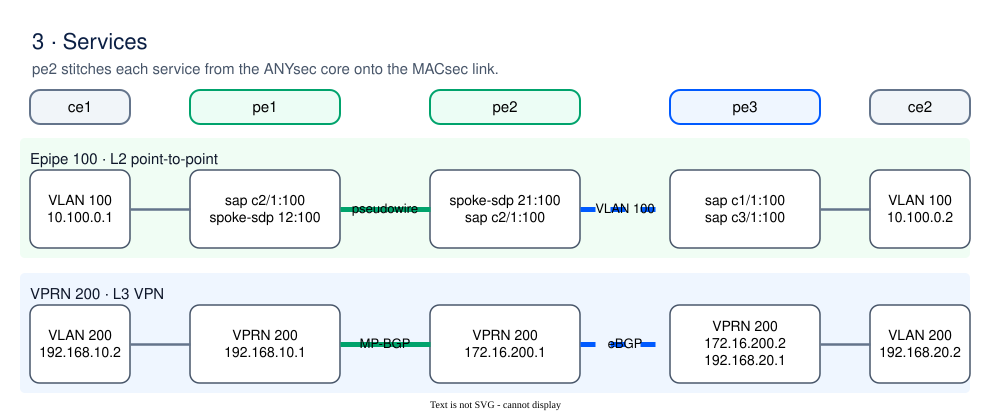
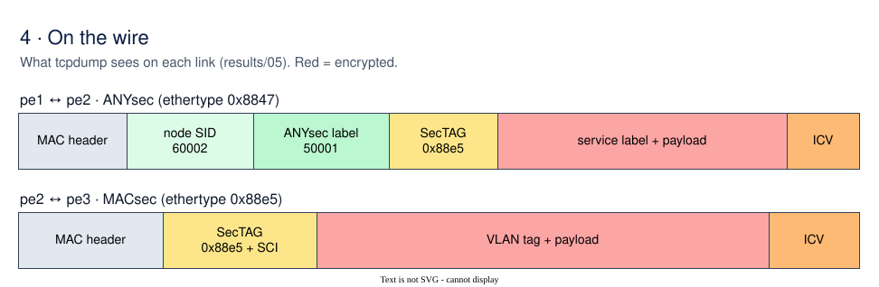

# ANYsec to MACsec Service Stitching Lab (Nokia SR OS 26.10.R1)

A [Containerlab](https://containerlab.dev) lab that carries an **Epipe** (L2 VPN) and a **VPRN** (L3 VPN) across two chained encryption domains:

1. **ANYsec** (MPLS encryption) over SR-ISIS between `pe1` and `pe2`.
2. **IEEE 802.1AE MACsec** on a dot1q access link between `pe2` and `pe3`.

`pe2` stitches the services between the two domains. Every packet on both links is encrypted; captures and CLI evidence are in [`results/`](results/).

The diagrams in [`docs/`](docs/) are `.drawio.svg` files: they render as images and open for editing in [draw.io](https://app.diagrams.net).

## 1. Hardware



| Node | SR-SIM model | Role | Mgmt IP |
|---|---|---|---|
| `pe1` | 7750 SR-1, FP5 `m5e10-100g-qsfp28` | ANYsec PE, customer access to `ce1` | 172.31.250.11 |
| `pe2` | 7750 SR-1, FP5 `m5e10-100g-qsfp28` | ANYsec PE + MACsec, service stitching | 172.31.250.12 |
| `pe3` | 7750 SR-1, FP5 `m5e10-100g-qsfp28` | MACsec PE, customer access to `ce2` | 172.31.250.13 |
| `ce1`, `ce2` | Linux | Customer hosts, VLAN 100 (Epipe) and VLAN 200 (VPRN) | .21, .22 |

All routers run SR OS 26.10.R1 with MD-CLI. Startup configs: [`configs/pe1.partial.cfg`](configs/pe1.partial.cfg), [`pe2`](configs/pe2.partial.cfg), [`pe3`](configs/pe3.partial.cfg).

## 2. Transport and encryption



From the Nokia 26.10.R1 documentation:

- **ANYsec and MACsec on one node:** if ANYsec is enabled on network ports, MACsec can only be enabled on access ports; if MACsec is enabled on a network port, ANYsec cannot be enabled. On `pe2`, `1/1/c1/1` is `mode network` with ANYsec and `1/1/c2/1` is `mode access encap-type dot1q` with MACsec.
- **Encryption label:** each encrypting router needs a unique ANYsec encryption label from a reserved label block. Here the block is `Anysec` 50000-59999 (SRGB 60000-120000); `pe1` uses 50001, `pe2` uses 50002.
- **CA:** an ANYsec connectivity association (`anysec true`) cannot also be used for MACsec, so there are two CAs: `CA-ANYSEC` (gcm-aes-xpn-256) and `CA-MACSEC` (gcm-aes-128).

## 3. Services



| Service | ce1 ↔ pe1 | pe1 ↔ pe2 (ANYsec) | pe2 stitching | pe2 ↔ pe3 (MACsec) | pe3 ↔ ce2 |
|---|---|---|---|---|---|
| **Epipe 100** | `sap 1/1/c2/1:100` | `spoke-sdp 12:100` / `21:100` (SR-ISIS SDP, T-LDP) | spoke-sdp 21:100 ↔ `sap 1/1/c2/1:100` | VLAN 100 | `sap 1/1/c1/1:100` ↔ `sap 1/1/c3/1:100` |
| **VPRN 200** | `192.168.10.1/24` | MP-BGP VPN-IPv4, RD/RT `65000:200`, auto-bind SR-ISIS | MP-BGP ↔ eBGP to AS 65200 on `172.16.200.0/30` | VLAN 200 | VPRN 200 (AS 65200), `192.168.20.1/24` |

## 4. On the wire



```text
pe1 <-> pe2 (ANYsec): node SID and encryption label in clear, then the SecTAG and encrypted payload
  ethertype MPLS unicast (0x8847), length 156: MPLS (label 60001, tc 0, ttl 255) (label 50002, tc 0, [S], ttl 255)
  0x0000:  0ea6 10ff 0c35 21ff 88e5 2c00 0000 000e

pe2 <-> pe3 (MACsec): everything after the MAC addresses, including the 802.1Q tag, is encrypted
  ethertype 802.1AE MACsec (0x88e5), length 134: an 0, pn 32, flags ECI, sci aac1ab0b51ac0001
```

SR-SIM captures show traffic entering a node, so each capture shows what the neighbour transmitted.

## Verified results

Collected by [`run-verification.sh`](run-verification.sh):

| File | Content |
|---|---|
| [`01-e2e-ping-verification.txt`](results/01-e2e-ping-verification.txt) | Epipe 100 and VPRN 200 ping ce1 → ce2: 5/5, 0% loss |
| [`02-anysec-verification.txt`](results/02-anysec-verification.txt) | ANYsec status, peer Up, SecY counters (Tx SCI `00000000c3520001`, OK packets, 0 not valid) |
| [`03-macsec-verification.txt`](results/03-macsec-verification.txt) | MKA sessions on pe2 and pe3: in-service, gcm-aes-128, latest SAK Rx/Tx yes |
| [`04-services-and-routing.txt`](results/04-services-and-routing.txt) | IS-IS, T-LDP, BGP, Epipe and VPRN state on all nodes |
| [`05-wire-packet-captures.txt`](results/05-wire-packet-captures.txt) | tcpdump on both links |

## Quick start

Requirements: Linux or WSL2 with Docker, Containerlab 0.80 or later, `sshpass`, `tcpdump`, and an SR-SIM license saved as `license26.txt` in the repository root (not committed).

```bash
docker pull registry.srlinux.dev/pub/nokia_srsim:26.10.R1
sudo containerlab deploy -t anysec-macsec.clab.yml
./run-verification.sh
```

Run a command on a router:

```bash
./sros.sh pe2 'show anysec tunnel-encryption encryption-group "EG-TUNNEL" peer 10.20.1.1 detail'
./sros.sh pe2 'show macsec mka-session port 1/1/c2/1 sub-port 1 detail'
./sros.sh pe3 'show router 200 route-table'
```

## Repository layout

| Path | Content |
|---|---|
| `anysec-macsec.clab.yml` | Containerlab topology |
| `configs/pe*.partial.cfg` | SR-SIM startup configs (MD-CLI) |
| `docs/*.drawio.svg` | Diagrams: hardware, transport, services, on the wire (draw.io) |
| `results/` | CLI outputs and packet captures |
| `run-verification.sh` | Pings, CLI collection and captures into `results/` |
| `sros.sh` | Run MD-CLI commands on a lab router over SSH |
